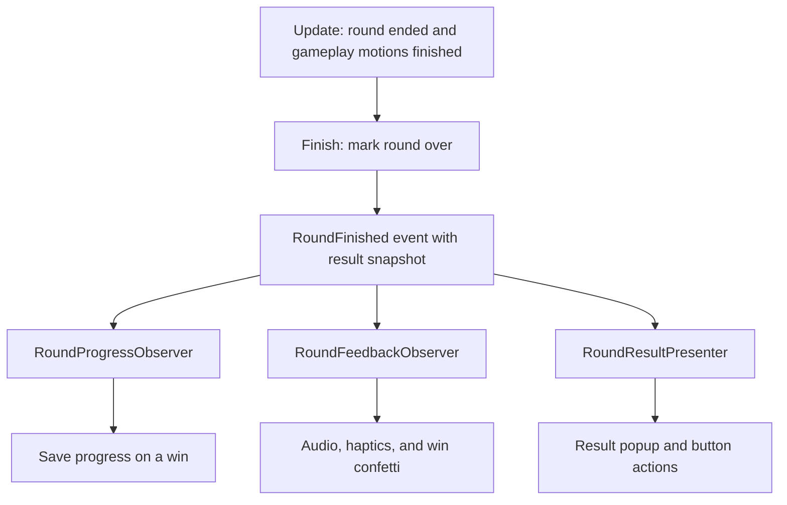

# RoundFinished Observer Pattern

## Purpose

Previously, `BusJamGame.Finish()` stopped the round and directly handled the
result popup, saved progress, sound, haptics, and celebration particles.

It now marks the round over and publishes an instance event:

```csharp
public event System.Action<RoundFinishedResult> RoundFinished;
```

Three observers subscribe to that event and perform the existing reactions.
This lets another system react to round completion without adding another
responsibility to `Finish()`.

## Participants

| Role | File | Responsibility |
| --- | --- | --- |
| Publisher | `Assets/Scripts/Gameplay/BusJamGame.cs` | Detect completion, stop further play, publish the result once. |
| Result data | `Assets/Scripts/Gameplay/RoundFinishedResult.cs` | Carry an immutable snapshot of the completed round. |
| Progress observer | `Assets/Scripts/Gameplay/RoundProgressObserver.cs` | Save the next unlocked level after a win. Ignore losses. |
| Feedback observer | `Assets/Scripts/Gameplay/RoundFeedbackObserver.cs` | Play win/loss audio and haptics. Emit confetti after a win. |
| UI observer | `Assets/Scripts/UI/RoundResultPresenter.cs` | Show the result popup and connect its buttons to claim, next level, replay, or retry. |



## Event contract

`Finish()` sets `_roundOver` before notifying observers. Repeated calls during
the same round return immediately. A valid `LoadLevel()` resets `_roundOver`,
allowing the next round to publish its own event.

The existing completion checks still run only when `IsBusy` is false. Boarding
and departure coroutines retain control of their sequence; this event announces
the outcome after those operations have finished.

`RoundFinishedResult` is a `readonly struct` with these values:

| Property | Meaning |
| --- | --- |
| `Won` | Whether the player won the round. |
| `LevelIndex` | Zero-based index of the completed level. |
| `NextLevelIndex` | Following level, capped at the final catalog index. Used to save winning progress. |
| `IsLastLevel` | Whether the completed level is the final catalog level. |
| `FailureReason` | `null` for a win; otherwise `No free bays` or `No moves left`. |

Observers use this snapshot instead of reading the live `RoundState`. Popup
callbacks also capture the snapshot, so their target level does not depend on
later changes to `BusJamGame.LevelIndex`.

The event runs synchronously on Unity's main thread. Standard C# event behavior
applies: callbacks run in subscription order, and an uncaught exception interrupts
the remaining callbacks. Keep observers independent and avoid changing levels
directly inside a completion callback. The built-in presenter waits for a button
action before loading a level.

## Preserved behavior

- A normal win shows `LEVEL COMPLETE`, `+100`, and `NEXT`.
- A final-level win shows `ALL LEVELS COMPLETE` and `PLAY AGAIN`. Replay loads
  level zero; saved winning progress remains capped at the final level until
  another level is loaded, matching the previous flow.
- A loss shows `TRY AGAIN`, the original failure reason, and `RETRY` for the
  completed level. The progress observer does not save a next level on a loss.
- Winning saves progress immediately. Coins are still awarded through
  `GameUI.ClaimReward()` when the player claims them, using the existing coin
  animation and double-click protection.

## Subscription lifetime

`BusJamGame.Start()` creates all three observers after audio, pools, and UI are
initialized, before loading the first level. They are ordinary C# objects and
subscribe in their constructors. Scene and prefab changes are unnecessary.

The game owns the observers for its lifetime. `OnDestroy()` calls `Dispose()` on
each observer to unsubscribe before destroying the UI, then clears any remaining
event subscriptions. Repeated disposal is safe. Disabling and enabling the game
does not construct another set of observers; subscriptions remain until the
owning game is destroyed.

## Adding another observer

For a component with a serialized reference to the game, pair subscription and
unsubscription with its enabled lifetime:

```csharp
using BusJam;
using UnityEngine;

public sealed class RoundCompletionLogger : MonoBehaviour
{
    [SerializeField] private BusJamGame _game;

    private void OnEnable() => _game.RoundFinished += OnRoundFinished;
    private void OnDisable() => _game.RoundFinished -= OnRoundFinished;

    private void OnRoundFinished(RoundFinishedResult result)
    {
        Debug.Log($"Level {result.LevelIndex + 1}: {(result.Won ? "won" : "lost")}");
    }
}
```

Assign `_game` in the Inspector. Subscribers receive future completions; the
event does not replay past results. A new plain C# observer can follow the
constructor/`Dispose()` pattern used by the built-in observers, with its owner
responsible for disposal.

## Validation

Runtime and Editor scripts were compiled with the Unity installation's C#
compiler and the project's existing assembly references.

A standalone check against the compiled production runtime assembly passed
16 assertions covering notification timing, multiple subscribers, duplicate
completion prevention, a subsequent round, unsubscription, snapshot stability,
final and single-level catalogs, both failure reasons, no subscribers, and
registration/disposal of all three built-in observers. These checks do not run
Unity's native UI, audio, particle, or PlayerPrefs operations.

`Assets/Editor/GameplaySmokeTests.cs` also checks a real winning round for one
notification, correct snapshot values, saved progress, no early coin award,
duplicate completion prevention, and the existing reward/next-level flow.
That Play Mode smoke test was extended and compiled, but was not executed as
part of this change.

To run it in a separate Unity batch session with this project closed:

```powershell
& 'C:/Program Files/Unity/Hub/Editor/2022.3.62f2/Editor/Unity.exe' `
    -batchmode -nographics -projectPath 'D:/Projects/Unity/game-training-weekly/Bus Jam' `
    -executeMethod GameplaySmokeTests.Begin -logFile 'Logs/RoundFinished-playchecks.log'
```

The test exits Unity when finished, restores its saved PlayerPrefs values, and
writes `Logs/Week6-playchecks.txt` on success. Do not add `-quit`, because the
test finishes asynchronously after entering Play Mode.
